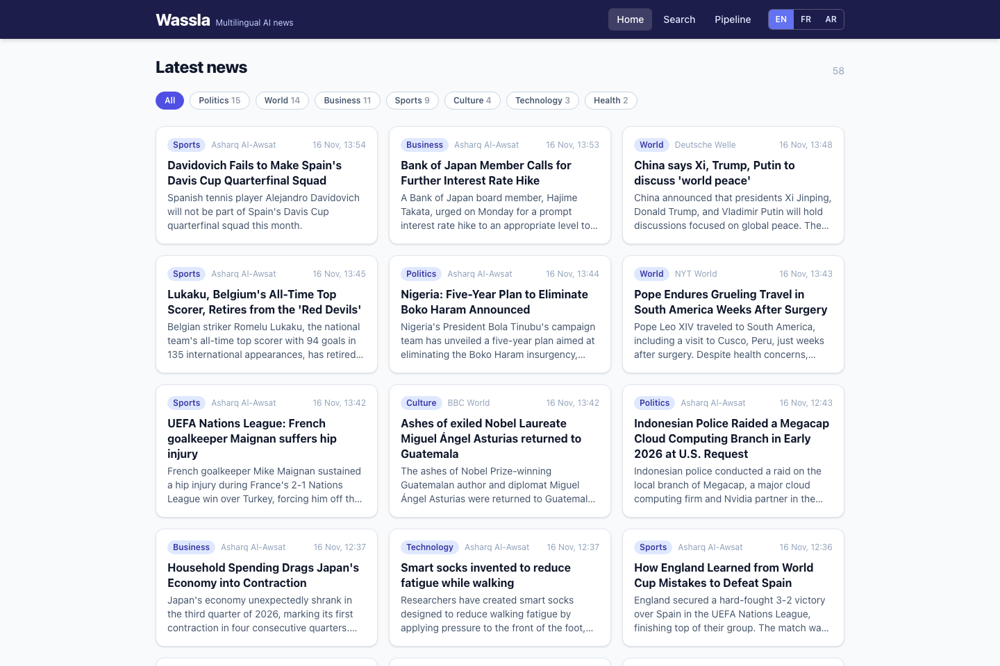
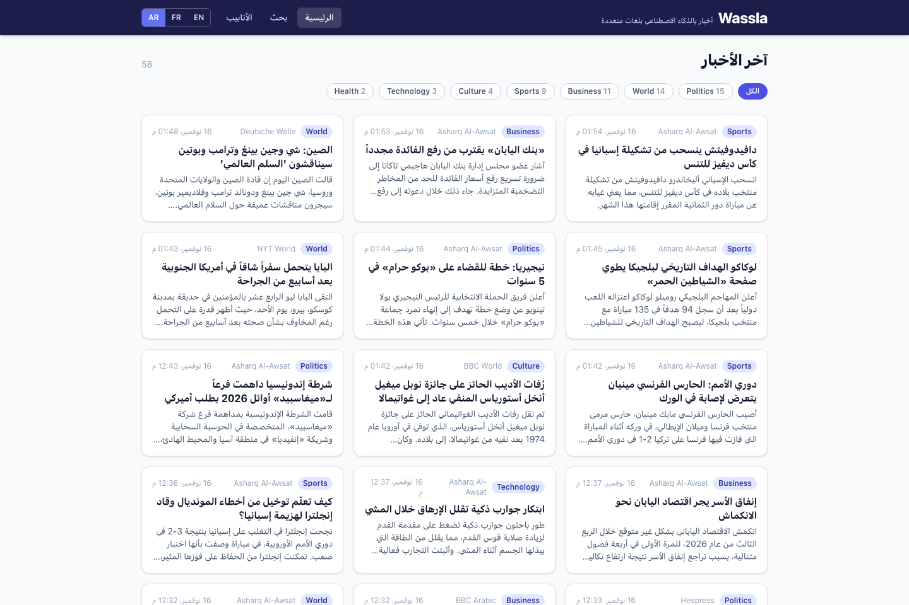
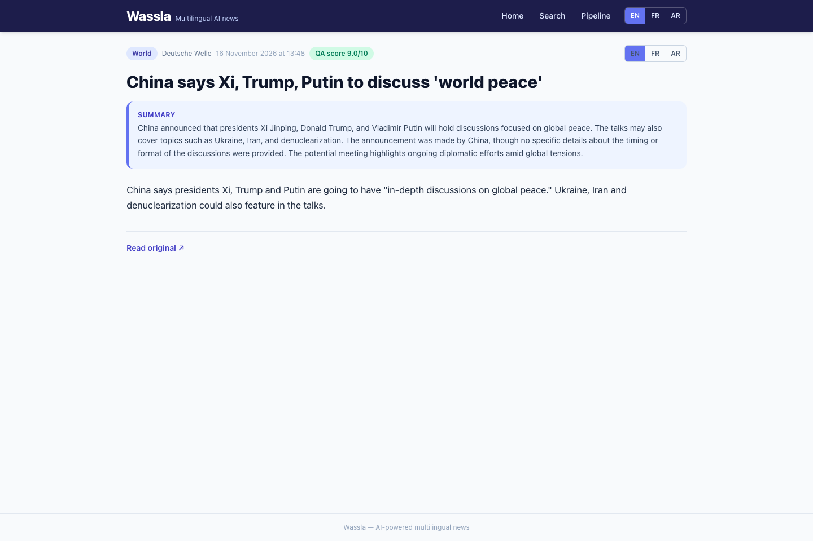
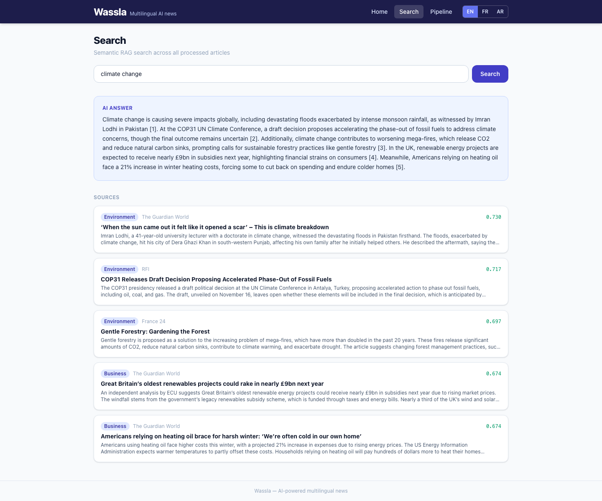
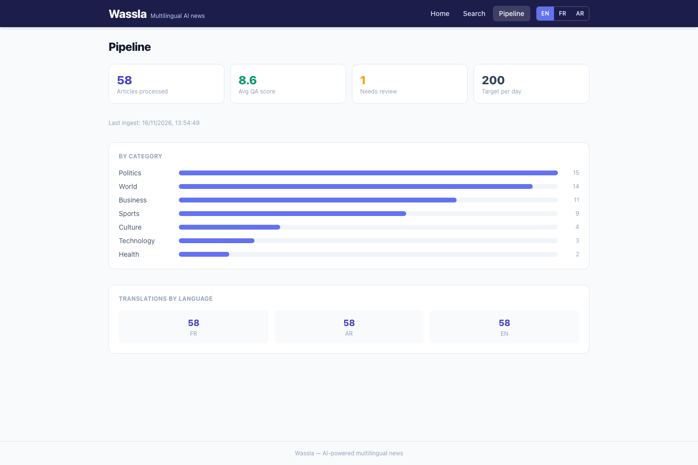
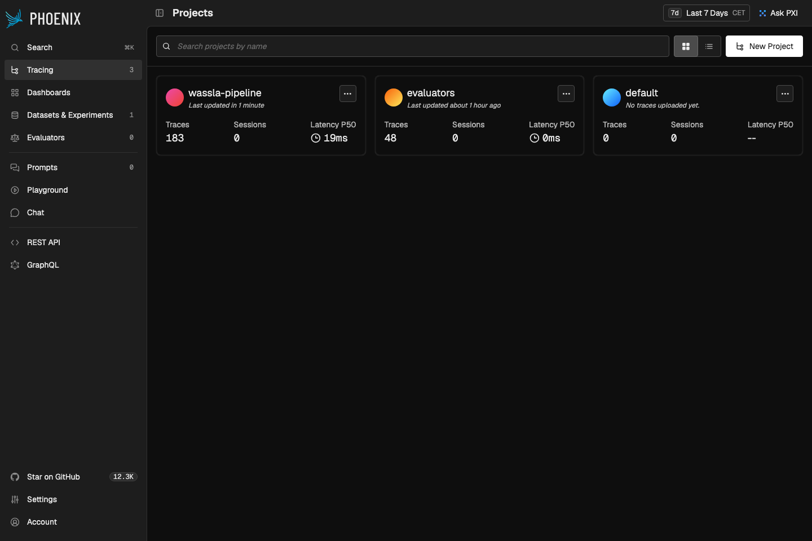

# Wassla

Multilingual AI news platform: RSS ingest → multi-agent LLM pipeline (translate,
categorize, summarize, QA-evaluate, embed) → PostgreSQL/pgvector → trilingual web
reader with semantic RAG search and a grounded, cited AI answer. Every LLM call and
agent step is traced to a local Phoenix UI, and offline eval experiments gate prompt
or model changes.

## Quickstart

```bash
# Set MISTRAL_API_KEY (or OPENAI_API_KEY) and INGEST_TOKEN (openssl rand -hex 32)
cp .env.example .env     
# docker compose up -d --build: db + pipeline + web + phoenix
make up                 
```


- Web UI: http://localhost:3000 · API docs: http://localhost:8000/docs · Phoenix UI: http://localhost:6006
- Ingest runs automatically every 15 min (pg_cron → pg_net). Manual trigger:

```bash
curl -X POST http://localhost:8000/ingest/run \
  -H "X-Ingest-Token: $INGEST_TOKEN" -H 'Content-Type: application/json' \
  -d '{"max_items": 50}'
```

- No API keys? `LLM_PROVIDER=stub` + `EMBEDDING_PROVIDER=stub` in `.env` for a deterministic smoke run.
- `make check` = lint + typecheck + tests (100% coverage enforced on both sides). `make fix` auto-fixes lint. `make evals` runs the eval experiments in docker. `make down` tears down.

## Services

| Service | Path | Exposed | Stack | Role |
|---|---|---|---|---|
| `db` | `db/` | 127.0.0.1:5432 | PostgreSQL 16 + pgvector + pg_cron + pg_net | Storage, vector search, ingest scheduling |
| `pipeline` | `pipeline/` | 127.0.0.1:8000 | Python 3.12, FastAPI, LangGraph, asyncpg, httpx, feedparser, OpenInference/OTLP | Ingest + LLM agent pipeline + REST API + traces |
| `web` | `web/` | :3000 | Nuxt 4 (Vue 3.5), Tailwind CSS 4, Nitro node-server | Trilingual SSR frontend + read-only API proxy |
| `phoenix` | — (image) | 127.0.0.1:6006 | Arize Phoenix (local, persistent volume) | Observability UI + eval datasets/experiments |

## What makes it tick

- **Env-driven config** — everything in `.env` (see `.env.example`), read via pydantic-settings.
- **Token-protected ingest** — `POST /ingest/run` checks `X-Ingest-Token` (hmac); the web proxy never forwards `/ingest/*`.
- **Two-level LangGraph** — outer graph fans out one article subgraph per item; the subgraph is a linear chain `translate → categorize → summarize → evaluate → embed → persist`.
- **Pluggable providers** — Mistral / OpenAI-compatible / deterministic `stub`.
- **Observability & evals always on in docker** — Phoenix traces every graph node and LLM call (tagged `task:*`), with latency and token usage; `make evals` replays a golden dataset through the graph and scores it (structural checks + LLM-as-judge), storing versioned experiments in Phoenix.

## Documentation

- [Quickstart](docs/quickstart.md) — setup, run, manual ingest, stub mode, all `make` commands
- [Architecture](docs/architecture.md) — diagrams: components, ingest, agent graph, RAG, tracing
- [db](docs/db.md) — image, schema, seed sources, cron job
- [pipeline](docs/pipeline.md) — config, providers, agent graph, REST API
- [web](docs/web.md) — pages, read-only proxy, i18n
- [Testing & lint](docs/testing.md) — test suites, coverage, `make check` / `make fix`
- [Observability & evals](docs/observability.md) — Phoenix tracing + `make evals` workflow

## Screenshots

Live captures from a local `make up` run (real ingest + searches, 58 articles in):

| | |
|---|---|
|  |  |
| Home page: latest processed articles, category chips, URL-driven pagination — English and Arabic | |
|  |  |
| Article page: selected-language translation with source, date and QA score | Semantic RAG search: grounded AI answer with [1], [2] citations plus source hits |
|  |  |
| Stats dashboard: articles processed, avg QA score, per-category/language counts | Phoenix UI: every ingest/search run traced — graph nodes, LLM spans, tokens, latency |
