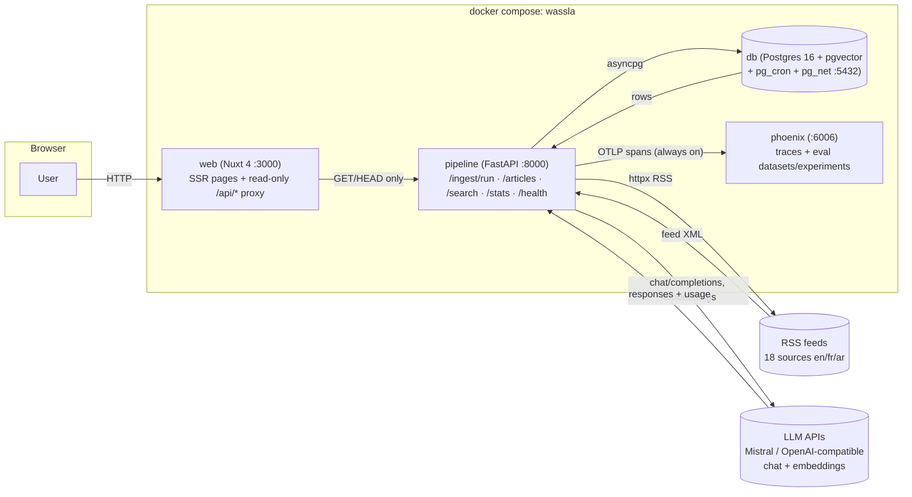
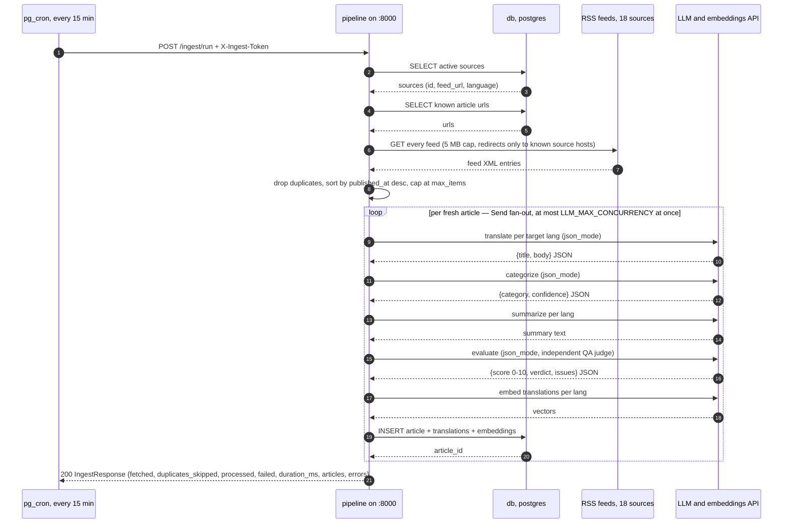
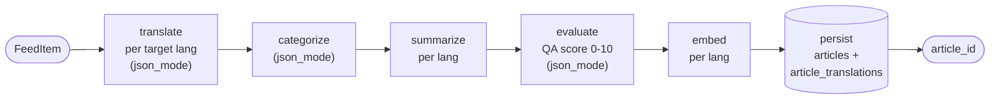
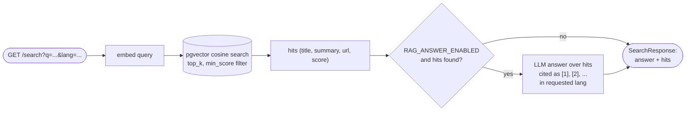

# Architecture

## Components

## Ingest sequence

## Per-article agent graph

One LangGraph subgraph invocation per article — a strict linear chain
(`graph/pipeline.py:build_article_graph`; `evaluate` only scores, it does not
branch — a low score is stored as status `needs_review`):

## RAG search

## Tracing

The pipeline instruments LangChain/LangGraph via OpenInference at startup
(`app/observability.py`, called first in `app/main.py`) and exports OTLP spans to
Phoenix. Every HTTP request becomes a trace: `POST /ingest/run → ingest →
process_article → LangGraph → translate/... → LLM` with per-span latency, model,
token usage, and tags (`ingest`, `article`, `eval`, `task:<name>`). See
[observability.md](observability.md).
